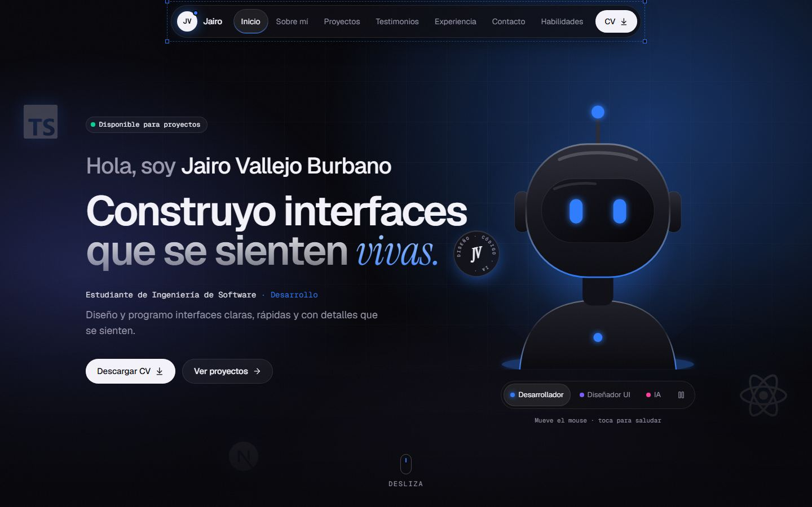
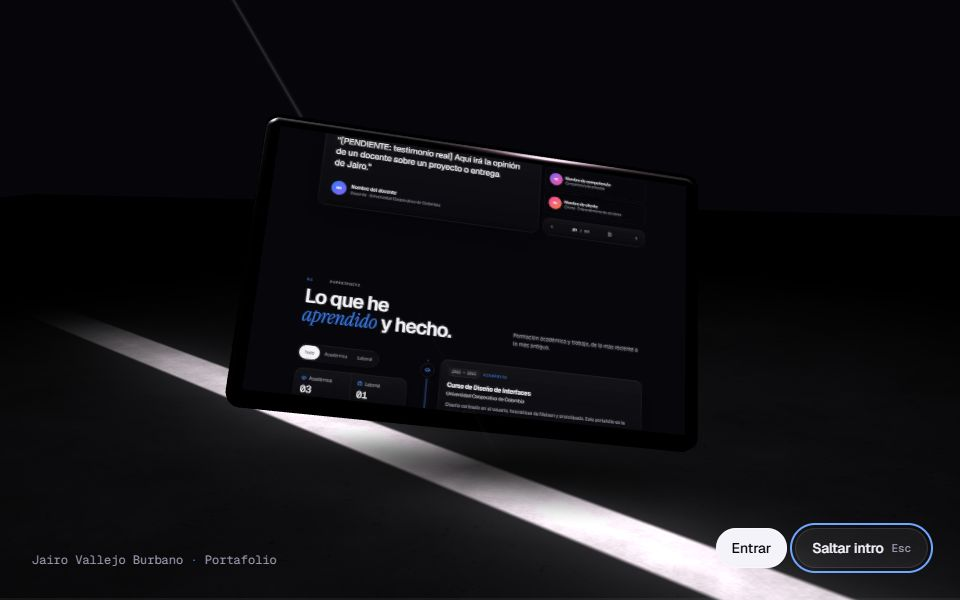
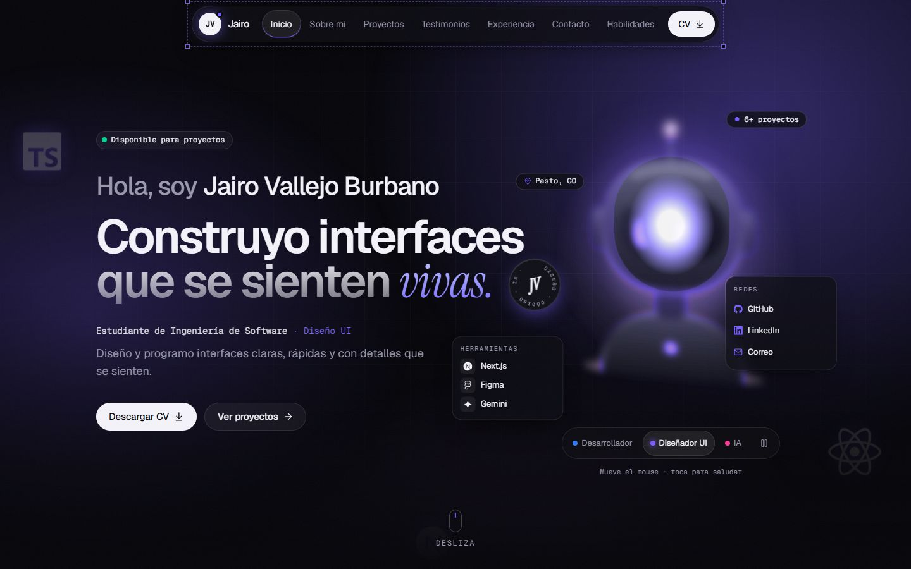
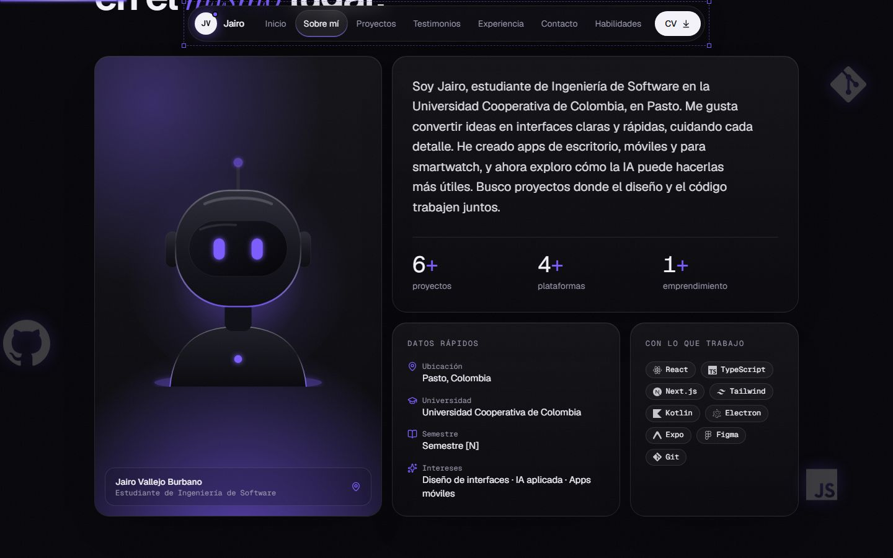
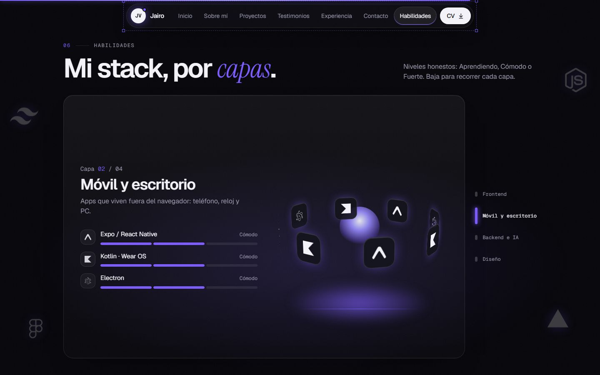
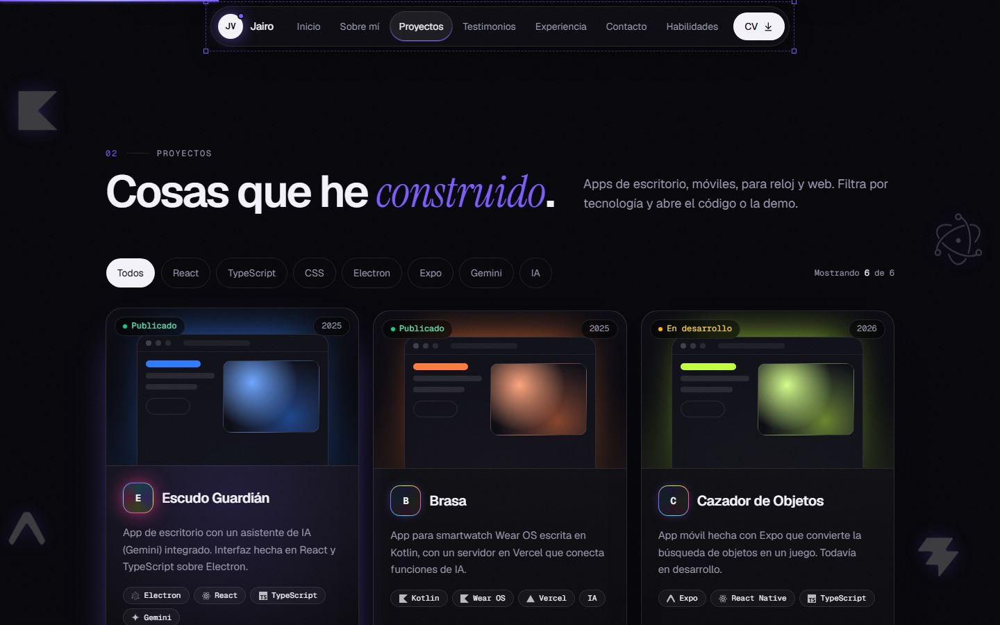

# Portafolio de Jairo Vallejo Burbano

Portafolio personal de **Jairo Vallejo Burbano**, estudiante de Ingeniería de Software en la Universidad Cooperativa de Colombia (Pasto). Es la entrega del curso **Diseño de Interfaces**.

> Dirección de arte **"Obsidian Aurora"**: fondo negro obsidiana con azul, violeta y magenta usados como luz (glows, bordes y halos), más vidrio y un 3D sutil.



## Experiencias principales

| | |
| --- | --- |
| **Intro «la pantalla en la sala oscura»**: una escena 3D (React Three Fiber) con piso de concreto procedural, un rayo de luz y una pantalla donde el portafolio hace scroll solo. Se muestra una vez por sesión, se puede saltar y tiene una versión CSS sin WebGL. |  |
| **Avatar con 3 modos**: Desarrollador, Diseñador UI e IA. Al cambiar de modo, el personaje colapsa en un orbe de luz, renace y **todo el sitio cambia de color** (`--accent` animado con `@property`). |  |
| **Storytelling con scroll**: el texto del Hero se desvanece y el avatar viaja hasta la tarjeta de «Sobre mí». |  |
| **Habilidades fija**: una tarjeta que cambia de capa con el scroll y un anillo de logos 3D en CSS. |  |
| **Proyectos**: filtros por tecnología, portadas que salen de la oscuridad con un barrido de luz e íconos holográficos. |  |

Todo tiene alternativa: en celular, con `prefers-reduced-motion` o con el interruptor **«Reducir efectos»** del footer y del menú móvil, el sitio usa versiones simples (sin pin, sin 3D y solo con fundidos).

## Stack

- [Next.js 16](https://nextjs.org) (App Router) + TypeScript
- Tailwind CSS v4, con tokens definidos en `@theme`
- [Motion](https://motion.dev) para las animaciones de UI
- three + @react-three/fiber + @react-three/drei para la intro, cargados con `next/dynamic` solo cuando hacen falta
- `lucide-react` y `simple-icons` para los íconos
- Playwright + sharp para las capturas, la textura de la intro y las pruebas visuales

## Cómo correrlo

```bash
npm install
npm run dev              # http://localhost:3000
npm run build            # build de producción
npm run lint             # ESLint
npx tsc --noEmit         # tipos
npm run check:content    # lista los TODO(Jairo) pendientes (-- --write actualiza PENDIENTES.md)
```

Los siguientes scripts necesitan `npm run build` y luego `npm start` corriendo en otra terminal:

```bash
npm run shots -- docs/capturas http://localhost:3000 jpg reduced   # capturas en 390/768/1440
npm run intro:texture    # regenera public/intro/site.webp (la pantalla de la intro)
npm run cv               # regenera el cv.pdf provisional
```

Variable opcional, en Vercel → Settings → Environment Variables (ver `.env.example`):

| Variable | Para qué |
| --- | --- |
| `NEXT_PUBLIC_FORMSPREE_ID` | Envío real del formulario con [Formspree](https://formspree.io). Sin ella, el formulario abre la app de correo. |

## Estructura

```
app/          layout.tsx · page.tsx · globals.css · not-found.tsx · icon.tsx · opengraph-image.tsx
components/   Navbar · Hero · About · Projects · Testimonials · Experience · Contact · Skills · Footer
  ui/         Reveal, HeroAvatar, HeroStage, AvatarTraveler, SkillsPinned, TechBackdrop, …
  three/      IntroGate (decide y controla), IntroScene (R3F), IntroCss (fallback 2D)
data/         profile · projects · testimonials · experience · skills (tipados)
lib/          effects (reduced-motion + «Reducir efectos») · mode (modos del avatar) · keys
public/       cv.pdf · images/ · avatar/ · intro/site.webp
scripts/      check-content · make-cv · screenshots · make-intro-texture
docs/         evaluacion-heuristica.md · capturas/
```

`app/page.tsx` sigue la guía del curso al pie de la letra: Navbar → Hero → Sobre mí → Proyectos → Testimonios → Experiencia → Contacto → Habilidades → Footer.

## Decisiones de diseño

- **El color es luz.** El fondo es plano (#06060A) y el color solo aparece en glows, bordes y halos. `--accent` cambia con el modo del avatar y se anima en CSS, sin JavaScript en cada frame.
- **Tipografía.** Geist para los títulos, con tracking ajustado y tamaños fluidos (`clamp`). Instrument Serif cursiva solo en una palabra de acento por título. Geist Mono para etiquetas y números.
- **Un solo sistema de botones** (primario, secundario y fantasma), con los mismos nombres en todo el sitio: «Descargar CV», «Código», «Ver demo».
- **Movimiento con propósito.** Un único easing `(.22,1,.36,1)`, apariciones con y + blur, y spotlight con el cursor. Con reduced-motion todo queda en un fundido simple.
- **Rendimiento.** three.js va en un chunk aparte y solo se descarga en escritorio cuando hay intro. En móvil no hay animación de entrada en el Hero (el texto es el LCP), ni `backdrop-filter`, ni grano, ni logos de fondo, ni animaciones dentro de SVGs.
- **Accesibilidad.** Enlace «Saltar al contenido», un solo `h1`, foco visible, `aria-current`, objetivos táctiles de 44 px o más, menú móvil con foco atrapado y cierre con Esc, carrusel con pausa y controles de la intro accesibles con teclado.
- **Honestidad.** Los niveles de habilidad se dicen en palabras, sin porcentajes inventados. Los testimonios y datos de contacto quedan marcados como pendientes y nunca se inventan.

## Calidad

- `npm run build`, `npm run lint` y `npx tsc --noEmit` pasan sin errores.
- Sin errores de consola ni scroll horizontal en 390, 768 y 1440 px (verificado con Playwright).
- **Lighthouse móvil (local):** Accesibilidad **100** · Buenas prácticas **100** · SEO **100** · Rendimiento **≈ 60**.
  - El rendimiento local no es confiable en este equipo: Chrome headless usa GPU por software (SwiftShader) y el TBT varía entre 0,7 s y 5 s en ejecuciones del mismo build. La misma variación se vio con el build anterior.
  - CLS = 0, FCP ≈ 1,1 s.
  - **Pendiente:** medir en [PageSpeed Insights](https://pagespeed.web.dev) con la URL de Vercel.
- Evaluación heurística, checklist de la guía (14 ítems) y mapa de las 10 heurísticas en [`docs/evaluacion-heuristica.md`](docs/evaluacion-heuristica.md).

## Publicar

### 1) GitHub (repositorio público)

Con GitHub CLI:

```bash
gh auth login
gh repo create portafolio-jairo --public --source=. --remote=origin --push
```

O manualmente: crea un repositorio vacío en github.com y luego ejecuta:

```bash
git remote add origin https://github.com/TU_USUARIO/portafolio-jairo.git
git push -u origin main
```

### 2) Vercel

1. Entra a [vercel.com/new](https://vercel.com/new) e inicia sesión con GitHub.
2. Importa el repositorio `portafolio-jairo`. Vercel detecta Next.js solo, así que no hay que cambiar nada.
3. Opcional: en *Environment Variables* agrega `NEXT_PUBLIC_FORMSPREE_ID`.
4. Pulsa **Deploy**. La URL pública queda en `https://portafolio-jairo.vercel.app` (o similar).
5. Cada `git push` a `main` vuelve a publicar el sitio automáticamente.

## Contenido pendiente

Ver [`PENDIENTES.md`](./PENDIENTES.md).
